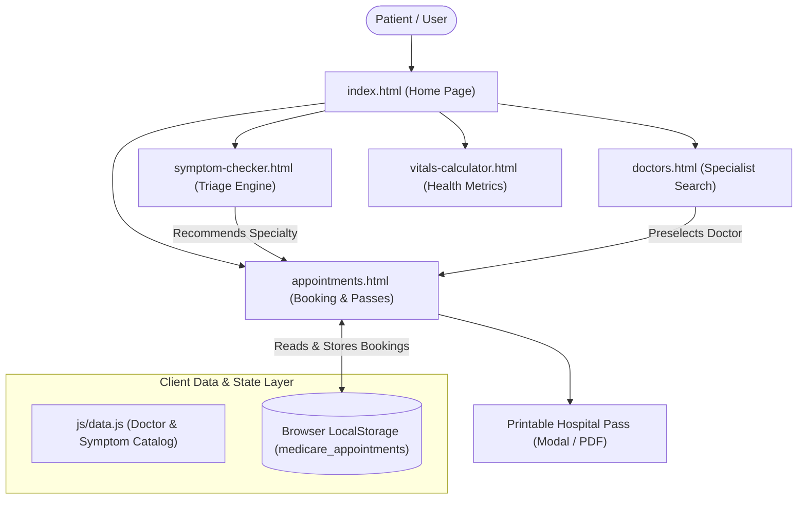

# MediCare+ | Smart Digital Healthcare & Symptom Triage Portal
### Web Technologies Project-Based Learning (PBL) Submission

---

## 1. Project Abstract
**MediCare+** is a comprehensive, responsive front-end web portal designed to address accessibility barriers in outpatient medical care. The portal combines an interactive **Clinical Symptom Triage Checker**, a **Specialist Doctor Directory with live search & filtering**, a complete **OPD Appointment Booking Engine with digital pass generation**, and a **Personal Health Vitals Calculator**. 

Built purely using **HTML5, CSS3, and modern Vanilla JavaScript (ES6+)**, the application requires zero external backend dependencies or server setup. All user appointments and theme preferences persist locally on the client machine via the **Browser LocalStorage API**.

---

## 2. Problem Statement & Key Objectives
- **Problem:** Patients often struggle to evaluate the urgency of their symptoms, determine which medical specialty they need to consult, or navigate long hospital OPD queues.
- **Objectives:**
  1. Provide a guided, non-diagnostic symptom triage algorithm to categorize patient symptoms into Mild, Moderate, or Urgent care.
  2. Map identified symptoms directly to medical specialties (Cardiology, Neurology, Pediatrics, Orthopedics, Dermatology, etc.).
  3. Offer an intuitive booking system that records patient appointments and renders a printable, official-looking **Hospital OPD Pass / Slip**.
  4. Educate users through daily health calculators (BMI, Hydration, and Caloric expenditure).

---

## 3. System Architecture



---

## 4. Technology Stack & Implementation Highlights

| Component | Technology | Implementation Details |
| :--- | :--- | :--- |
| **Markup** | HTML5 Semantic Elements | `<header>`, `<main>`, `<nav>`, `<section>`, `<article>`, `<dialog>`, `<footer>` |
| **Styling** | Modern CSS3 | CSS Variables (`:root`), Flexbox, CSS Grid, Media Queries, Dark/Light Mode, `@media print` |
| **Logic** | Vanilla JavaScript (ES6+) | DOM manipulation, Event Listeners, Dynamic Filtering, Arrow functions, Set/Map |
| **Persistence** | Web Storage API | `window.localStorage` storing appointments array as serialized JSON |
| **Assets** | Zero external heavy libs | Fast loading, 100% offline-capable, runs anywhere |

---

## 5. Directory Structure

```
Medicare-PBL/
├── index.html                  # Landing page (Hero, Services, Testimonials, Quick Stats)
├── symptom-checker.html        # Multi-step interactive health triage wizard
├── doctors.html                # Specialist directory with real-time search & filters
├── appointments.html           # Booking form, time slot picker, & My Appointments dashboard
├── vitals-calculator.html      # BMI gauge, Water Intake, & Caloric target calculators
├── css/
│   └── style.css               # Unified styling, theme variables, dark mode, responsive layout
├── js/
│   ├── data.js                 # Central mock repository for doctors, departments, and symptoms
│   ├── main.js                 # Dark/Light mode theme switcher, mobile menu, toast alerts
│   ├── symptom-checker.js      # Weighted symptom scoring algorithm & department recommendation
│   ├── doctors.js              # Live text search and specialty filtering logic
│   ├── appointments.js         # Slot selection, form validation, localStorage CRUD, pass modal
│   └── vitals.js               # Mathematical equations for BMI, hydration, and Mifflin-St Jeor TDEE
└── README.md                   # Project report, system architecture, and viva questions
```

---

## 6. How to Run the Project
1. Navigate to the project directory:
   ```
   c:\Users\ysravanthi\Medicare-PBL\
   ```
2. Double-click **`index.html`** or open it using any modern web browser (**Google Chrome**, **Microsoft Edge**, **Mozilla Firefox**, or **Brave**).
3. No web server, Node.js, Python, or database setup is needed!

---

## 7. College Viva / Evaluation Q&A (Quick Reference)

**Q1: How does the application store appointment records without a backend database?**  
> *Answer:* We utilize the HTML5 **Web Storage API (`localStorage`)**. Data is serialized as JSON strings using `JSON.stringify()` and retrieved with `JSON.parse()`. This ensures booked appointments persist even if the user refreshes or closes the browser.

**Q2: How does the Symptom Checker evaluate triage risk?**  
> *Answer:* Each symptom is assigned a base severity weight in `js/data.js`. When the user completes the assessment, the total score is computed based on:
> $$\text{Total Score} = \left(\sum \text{Symptom Weights}\right) \times \text{Duration Multiplier} \times \left(\frac{\text{Pain Slider}}{5}\right)$$
> Critical red-flag symptoms (like chest tightness or severe neurological signs) trigger immediate High-Urgency triage regardless of the base score.

**Q3: How is Dark Mode implemented?**  
> *Answer:* CSS custom properties (`:root` variables) define the color scheme for background, text, borders, and shadows. Toggling the theme toggles a `.dark-mode` class on the `<body>`, which redefines these variables, and the preference is preserved across page navigations via `localStorage`.

**Q4: How does the Hospital Pass printing work?**  
> *Answer:* We use CSS `@media print` directives to hide navigation bars, buttons, and background elements, leaving only the official appointment verification slip visible when `window.print()` is executed.
